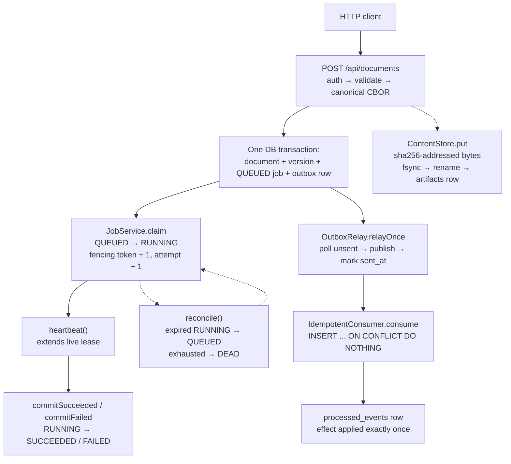
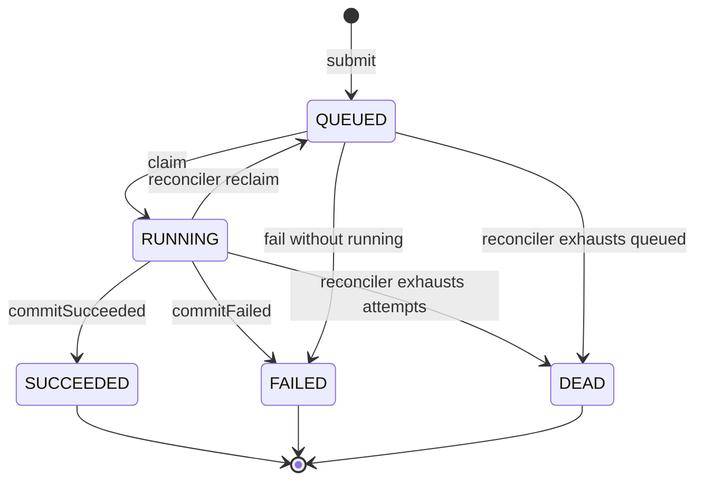

# Architecture

Current implemented system: capability-secure, deterministically replayable execution fabric with DB-enforced tenant isolation (single-tenant seed `t_single`, multi-tenant safe).

Stack: Java 25 (Temurin LTS), Spring Boot 4.1.1, Spring Web (MVC), JDBC, Validation, Flyway, PostgreSQL driver. Tests use Testcontainers `postgres:18` (see `src/test/java/com/g1do/anvil/TestcontainersConfiguration.java`). Local run uses Boot Dev Services; `src/main/resources/application.yaml` sets only the app name.

## Data flow

`POST /api/documents` → `X-Tenant-Id` auth → validate → canonical CBOR → one DB transaction (document + version + job + outbox) → `JobService` claim/heartbeat/commit/reconciler → `OutboxRelay` publish + `sent_at` mark → `IdempotentConsumer`. Bytes go through `ContentStore` (filesystem + `artifacts` rows).

The diagram shows how one submit fans out into the claim path and the relay path; dashed edges are background recovery and side paths.

## Submit

- Routes: `POST /api/documents` (aliases `/api/v1/documents`, `/documents`). Headers `X-Tenant-Id`, `Idempotency-Key`. Body `{"title","mime_type","body"}` where `body` is a JSON string treated as UTF-8 bytes for CBOR `bstr`. See `src/main/java/com/g1do/anvil/submit/SubmitController.java` and `src/main/java/com/g1do/anvil/submit/SubmitService.java`.
- Valid request returns `202` with `{"doc_id","version_id","job_id"}` on first and duplicate delivery; same `(tenant_id, idempotency_key)` returns the same IDs with exactly one job row (DB `UNIQUE(tenant_id, idempotency_key)`, fast-path re-read plus `DuplicateKeyException` replay of the winner).
- One DB transaction writes document, `document_versions` (version 1), `jobs` (`QUEUED`), and `outbox` (`job.committed`); validation or persistence failure leaves none behind.
- Canonical form: RFC 8949 core-deterministic over `{title, mime_type, body}` only (`jackson-dataformat-cbor` with `SORT_PROPERTIES_ALPHABETICALLY`); `version_sha = sha256(canonical_cbor)`. See `src/main/java/com/g1do/anvil/submit/CanonicalCbor.java`.
- Validation limits live in `SubmitService`: title required ≤4096, `mime_type` required ≤255, `Idempotency-Key` required ≤255, `body` must be present; unknown tenant → `401`.

## Jobs: fenced claim, heartbeat, commit, reconciler

See `src/main/java/com/g1do/anvil/jobs/JobService.java`.

- Claim is one atomic statement: candidates `WHERE tenant_id + state='QUEUED' + unheld/expired lease + attempt < max_attempts ORDER BY created_at, id LIMIT 20 FOR UPDATE SKIP LOCKED` (uses `jobs_claim_idx`), then `QUEUED -> RUNNING` with `fencing_token + 1`, `attempt + 1`, `lease = clock_timestamp() + 10s`. The `attempts` ledger row (`UNIQUE(tenant_id, job_id, attempt_number)`) is written in the same transaction: zero lost, zero doubled.
- Heartbeat extends only a live lease held by the same owner and token (`RUNNING` plus `lease_expires_at > clock_timestamp()`).
- `commitSucceeded/Failed` moves `RUNNING -> SUCCEEDED/FAILED` only when id plus owner plus fencing token plus `RUNNING` all match; a stale owner affects zero rows. Terminal rows (`SUCCEEDED/FAILED/DEAD`) are additionally immutable via the `job_state_guard` trigger.
- Capability gate (issue #21): every commit requires a valid `cap_grants` row for `(tenant_id, job_id)`. `issueCap` creates epoch 1 (re-issue bumps epoch, superseding the old), `revokeCap` sets `revoked=TRUE`, expiry is `clock_timestamp() + 1h` (DB clock only). The commit transaction sets tenant context first, then locks the grant `FOR UPDATE` (`WHERE tenant_id = ? AND job_id = ?` for the current-grant path, `WHERE id = ? AND tenant_id = ? AND job_id = ?` for the explicit-cap path) and validates `epoch + revoked + expires_at` before any `jobs` write. Missing/revoked/expired/superseded/cross-tenant denies atomically: 0 job rows, `403 NEEDS_APPROVAL` (`CapDeniedException`), `cap_rejected` incremented; fencing failures still return `false` with no exception. Grants are tenant-bound via composite `FOREIGN KEY(tenant_id, job_id)` plus `WHERE tenant_id` and RLS; no cross-tenant dedup. Post-grant TOCTOU (revoke committed after the commit txn commits) is residual by definition.
- `reconcile(tenant)` / `reconcileAll()` is the polling reconciler (intended `1s`): expired `RUNNING` with attempts left returns to `QUEUED` (reclaimable with a new token); `QUEUED` or expired `RUNNING` at or beyond `max_attempts` moves to `DEAD` and is never re-offered. Terminals are never claimable. `reconcileAll()` iterates `tenants` and runs each `reconcile(tenant)` in its own tenant transaction (one transaction cannot hold two tenants; no global `UPDATE` without `WHERE tenant_id = ?` is issued).

The diagram shows the legal job lifecycle enforced by the `job_state_guard` trigger; any other transition fails in the database.

- Only the database clock (`clock_timestamp()`) decides leases; worker clocks never do. At-least-once with idempotent fenced effects; exactly-once is not asserted.

## Content store

See `src/main/java/com/g1do/anvil/cas/ContentStore.java`.

- `put(tenant, bytes)` returns `sha256(bytes)` (lowercase hex), stored under `tenants/{tenant}/{sha}` (`anvil.cas.root`, default `var/cas`); no cross-tenant deduplication. `get(tenant, sha)` re-verifies the hash.
- Durability order is mandatory: tmp-write in the destination directory → fsync file → atomic rename → fsync directory, then the `artifacts` row is written. The final name appears only via atomic rename; a hash mismatch is a torn tail and is removed rather than served (`CorruptContentException`).
- `acquire` / `release` drive `artifacts.refcount`. `collectGarbage()` deletes only `refcount = 0` rows older than `GC_grace=1h` (DB clock), re-checking each row `FOR UPDATE` so a newly referenced SHA is retained, then sweeps crash orphans (files without rows, old tmp files) by file mtime. Any ambiguity retains rather than deletes.

## Reads: direct-ID, search, CAS gateway, presigned

See `src/main/java/com/g1do/anvil/read/ReadService.java`, `src/main/java/com/g1do/anvil/read/DocumentSearchController.java`, `src/main/java/com/g1do/anvil/cas/ContentStore.java` (`getForCaller`), and `src/main/java/com/g1do/anvil/cas/CasPresignedService.java`.

- Direct-ID fetches (`ReadService.getDocument/getVersion/getJob/getAttempt/getArtifact/getOutboxEvent`): every call sets transaction-local `app.tenant` with a read-back probe and queries `WHERE id = ? AND tenant_id = ?` (or `tenant_id + sha256` for artifacts) under RLS `FORCE`. Cross-tenant IDs return the same empty result as missing IDs: deny without content, no existence oracle, 0 rows leaked. Forged claim/commit (`tenant+job`, `tenant+job+token`) deny via the same tenant-scoped `WHERE` plus the capability gate (`403 NEEDS_APPROVAL`, `cap_rejected++`, 0 rows).
- Minimal search is `GET /api/documents?query=&limit=&cursor` (aliases `/api/v1/documents`, `/documents`). Tenant comes solely from `X-Tenant-Id` via `TenantAuthFilter`/`TenantContext`; any `tenant`/`tenant_id` query param is accepted but ignored. Storage is `WHERE tenant_id = :t AND title ILIKE :prefix% ORDER BY created_at, id` (prefix `%, _, \` escaped, `ESCAPE '\'`) with RLS underneath, a SQL pre-filter, and a per-row Java re-check (`ReadService.recheck`) that drops race-inserted cross rows. No GIN/FTS, no jobs/artifacts full-text (those listings are RLS list-filter checks only), no public shares. Cursor pagination is keyset on `(created_at, id)`: the cursor is a document UUID resolved tenant-scoped, so replaying B's cursor as A resolves to zero rows and returns 0 rows (fail closed). Limits default `20`, capped at `100`.
- CAS gateway is `ContentStore.getForCaller(caller, resource, sha)`: denies without content (`NoSuchFileException` with the caller-scoped address, indistinguishable from missing) when `caller != resource`, when no `artifacts` row exists for `(caller, sha)` under RLS, or when the file is absent. Traversal (`../`) and encoded traversal (`%2e%2e`, double-encoding via `%`) are rejected by `requireTenant`/`requireSha` (`400`-class, never reaches the filesystem). Same bytes in two tenants are two files and two rows; per-tenant GC never deletes the other. Direct-FS paths are never exposed via the API: the gateway is the only read path. The raw `get` stays hash-verified for crash recovery (rowless files remain readable).
- Presigned CAS URLs (`CasPresignedService`, TTL `60s`, DB clock only): token is `base64url(payloadJson) + "." + HMAC-SHA256(secret, base64Part)` binding `(tenant, sha, job, cap, epoch, expiry)`. Issue requires an `artifacts` row plus a job row plus a valid current grant for `(tenant, job)` (else `403`); verify re-checks signature (constant-time), expiry, rows, and the presented grant under `FOR UPDATE` via `JobService.checkPresentedGrant` (revoke/expire/supersede/cross denies `403 NEEDS_APPROVAL`, `cap_rejected++`). Swapped tenants, tampered sha/expiry/signature, expired, and revoked replays all deny `403` without content. Re-uploading the same bytes as another tenant yields an attacker-scoped URL only. The secret is `anvil.cas.presign-secret` or an ephemeral random key (restart invalidates outstanding URLs, fail closed).

## Outbox relay and consumer

See `src/main/java/com/g1do/anvil/outbox/OutboxRelay.java` and `src/main/java/com/g1do/anvil/outbox/IdempotentConsumer.java`.
- `relayOnce(publisher)` iterates `tenants` and relays each via `relayOnce(publisher, tenant)`; the tenant pass polls `WHERE tenant_id = ? AND sent_at IS NULL ORDER BY id LIMIT 100 FOR UPDATE SKIP LOCKED` (uses `outbox_poll_idx`), publishes each event with its stable identity (`outbox.id` as `event_id` in payload plus `event_id` header: `{event_id, tenant_id, job_id, doc_id, version_id, type:"job.committed", sha256}`), then marks `UPDATE outbox SET sent_at ... WHERE id = ? AND tenant_id = ? AND sent_at IS NULL` in a separate transaction after publish. A publish throw skips the mark, so a crash between publish and mark re-publishes the same identity rather than losing it; exactly-once delivery is not asserted.
- `consume(event)` runs `INSERT INTO processed_events ON CONFLICT DO NOTHING` in one transaction and applies the effect only when the insert wins. Idempotency lives in the database, not in relay memory. Concurrent relays may both publish the same row when polls interleave, but the second mark is a no-op and the consumer still applies once. Progress is durable `sent_at`.

## Execution jail

See `src/main/java/com/g1do/anvil/exec/ExecJail.java`, `JailEgress.java`, `JailResult.java`, `EgressDeniedException.java`.

- Filesystem: per-tenant writable workspace only (`<anvil.exec.root>/<tenant>`, default `var/exec-workspaces`). Every file operand resolves via `resolveInWorkspace`, which denies absolute paths, `..` segments, `%` (encoded traversal), and null bytes with `SecurityException`, plus anything normalizing outside the workspace and any path traversing a symlink (fail-closed, even inside-pointing links deny; read-only-root at the API layer). Tenant names follow the same escape rules as the CAS store. Authenticated reads go through `readWorkspaceFile(caller, resource, rel)`: `caller != resource` denies with a caller-scoped `NoSuchFileException` (no content, no oracle), mirroring the CAS gateway.
- Process: `run(tenant, argv, extraEnv, timeout)` forks a real child with its working directory set to the tenant workspace. The environment is cleared first (`env -i` equivalent); only `PATH=/usr/bin:/bin`, `ANVIL_TENANT=<tenant>`, and validated `extraEnv` entries survive (`ANVIL_TENANT`/`PATH` cannot be overridden; `LD_*`/`DYLD_*`/`PYTHON*`/`PERL*`/`RUBY*`/`NODE_*`/`IFS`/`BASH_ENV`/`ENV`/`ZDOTDIR` deny). Shell interpreters deny, every operand with an absolute path, a `..` segment, or `%` denies, workspace executables deny, and symlink-traversing operands deny. `argv` executes directly with no shell. Stdout/stderr cap at 1 MiB per stream (truncated + flag). Timeout kills the child and throws.
- Egress: default-deny via `JailEgress.checkAllowed` (no allowlist in v1: every URL denies, including public hosts, without network). Blocked targets (always denied, even when allowlisted) are `localhost`/`*.localhost`, metadata names, IPv4 `127/8`, `10/8`, `172.16/12`, `192.168/16`, `169.254/16`, `0/8`, IPv6 `::1`/expanded `0:0:0:0:0:0:0:1`/`::`/expanded `0:0:0:0:0:0:0:0`/`fe80::/10`/`fc00::/7`/`ff00::/8`/`::ffff:/96`, non-canonical numerics (single-integer, hex-integer, hex-dotted), non-`http(s)` schemes, and userinfo URLs. `newClient()` builds an `HttpClient` with `followRedirects(NEVER)`; the untrusted path must check-then-send with this client. Denials throw `EgressDeniedException` with a generic reason only (no URL/host echo).
- Residual: no mount/user/network namespace in v1, so the kernel still permits raw `../sibling` or `/tmp` from arbitrary native code once it runs (interpreter `-c` strings, workspace binaries, and `/proc` bypass the argv allowlist; `run` is trusted-caller-only with direct `argv` and validated workspace-relative operands, and symlink check-then-use has TOCTOU). No DNS resolution is performed (DNS-rebind residual), non-canonical IP encodings deny as non-canonical rather than decoding, and there is no nftables DROP. Full SsrfMatrix hardening is deferred.

## Database

`src/main/resources/db/migration/V1__durable_v1_schema.sql` defines the durable slice: `tenants, documents, document_versions, jobs, attempts, artifacts, outbox, processed_events`, plus the `job_state_guard` trigger, `jobs_claim_idx` / `jobs_running_lookup_idx` / `jobs_lease_expiry_idx` / `outbox_poll_idx`, and the `active_jobs` / `claimable_jobs` / `unclaimed_outbox` views. Tenant isolation is composite `FOREIGN KEY(tenant_id, xxx_id)` edges plus DB-enforced RLS. `src/main/resources/db/migration/V2__tenant_rls.sql` enforces it: `anvil_migrator` owns tables/views/function, runtime role `anvil_app` is `NOSUPERUSER NOBYPASSRLS`, `RLS FORCE` on all tenant-scoped tables (`documents, document_versions, jobs, attempts, artifacts, outbox, processed_events`; `tenants` intentionally has no RLS as the auth lookup target) with one policy per table `tenant_id = current_setting('app.tenant', true)` (`USING` + `WITH CHECK`), views `security_invoker=true`, no `SECURITY DEFINER`. `src/main/resources/db/migration/V3__cap_grants.sql` adds `cap_grants` (`id, tenant_id, job_id, epoch, revoked, expires_at`, `UNIQUE(tenant_id, job_id)`, composite `FOREIGN KEY(tenant_id, job_id)` to `jobs`, migrator-owned, app DML, `RLS FORCE` + `tenant_isolation` policy): one authoritative grant per `(tenant, job)`, per-tenant with no cross-tenant dedup. `src/main/resources/db/migration/V4__audit_events.sql` adds `audit_events` (`tenant_id, job_id, seq, prev_hash, event_hash, type, payload`, `UNIQUE(job_id, seq)`, `UNIQUE(job_id, prev_hash)` fork guard, composite `FOREIGN KEY(tenant_id, job_id)` to `jobs`, per-tenant with no cross-tenant dedup, migrator-owned, app `SELECT+INSERT` only, `RLS FORCE` + `tenant_isolation`, `audit_events_immutable` trigger rejecting `UPDATE`/`DELETE` for every role). Every transaction that touches tenant rows sets `SET LOCAL app.tenant` via `TenantGuard.setTenant` (`SELECT set_config('app.tenant', ?, true)`) with a `current_setting('app.tenant', true)` read-back probe; `SET LOCAL` resets on commit/rollback so pooled reuse cannot leak, missing context reads zero rows (fail closed), and every hot-path statement keeps an explicit `WHERE tenant_id = ?` in addition to RLS. The migration headers document assumptions, legal transitions, and canonical claim/relay queries.

## Audit log

See `src/main/java/com/g1do/anvil/audit/AuditChain.java`, `src/main/resources/db/migration/V4__audit_events.sql`, `src/main/java/com/g1do/anvil/submit/CanonicalCbor.java` (`encodeMap`).

- Chain: per-job 0-based `seq`, `prev_hash = 'GENESIS'` for seq 0 else the previous `event_hash`; `event_hash = sha256_hex(type + 0x00 + job_id + 0x00 + seq + 0x00 + prev_hash + 0x00 + canonical_cbor(payload))` with the existing mapper (`SORT_PROPERTIES_ALPHABETICALLY` + `ORDER_MAP_ENTRIES_BY_KEYS`). Serialization for concurrent appends comes from locking the parent `jobs` row `FOR UPDATE` (runtime holds `UPDATE` on `jobs`; it holds only `SELECT+INSERT` on `audit_events`, so the tail is read without `FOR UPDATE` on the child).
- Logged in the same DB transaction as the effect: `submit` (`doc_id, version_id, sha256`), `claim` (`state=RUNNING`), `commit` (`outcome=SUCCEEDED/FAILED/DEAD`, including reconciler `DEAD` via `UPDATE ... RETURNING`), `cap.issue` (`epoch, cap_id`) / `cap.revoke` (`epoch`), `cas.put` (`artifact_sha, size_bytes` via `ContentStore.putForJob/linkArtifactToJob`). Payloads never contain `owner, fencing_token, lease_expires_at, attempt, created_at/sent_at/updated_at` or tenant context (`AuditChain` rejects them). Not logged: `heartbeat`, reconciler reclaim (`RUNNING -> QUEUED`), empty reconciler polls, `outbox.sent_at`. Duplicate resubmit returns the winner without a second `submit` event (no fork); fencing misses (0 rows) and cap denials (exception, rollback) append nothing.
- Raw `ContentStore.put/acquire` without a job stays unaudited for non-job content; job-scoped `putForJob/linkArtifactToJob` is the audited path (same txn: artifacts upsert + audit; file durability order unchanged).

## Verification proofs

`./mvnw test` boots the full context against containerized Postgres. The test classes prove:

- `DurableV1SchemaTest`: tables, legal-transition guard (terminals immutable), claim/relay indexes used (no `Seq Scan`).
- `SubmitIdempotencyTest`: duplicate `(tenant, key)` returns the same IDs with one job row; validation/persistence failure leaves nothing behind.
- `JobServiceTest`: fencing (stale owner affects zero rows), heartbeat/commit guards, reconciler (`QUEUED` reclaim vs `DEAD`), attempts ledger exactly once, gate-scale contention (naive select-then-update double-claims ≥1/500; atomic CTE zero double-claims/2000 with ledger exact and terminals never offered), zombie resume with real suspend past TTL (resumed worker's heartbeat/commit affect zero rows).
- `ContentStoreTest`: crash-safe put/get (tmp-write, atomic rename, torn-tail removal), refcount GC (referenced SHAs retained, old orphans reclaimed, young retained), real-kill proofs during tmp-write, rename-before-row, and GC file-before-row with hash-verified reads and zero torn bytes.
- `OutboxRelayTest`: ghost redelivery (kill between publish and mark re-publishes the same `event_id` with one `processed_events` row), dedup (`ON CONFLICT DO NOTHING`), concurrent relays apply once.
- `RlsLeakTest`: DB-enforced isolation on containerized Postgres with a shared Hikari pool as `anvil_app` — `RLS FORCE` + policies + `NOSUPERUSER NOBYPASSRLS` + migrator ownership + no `SECURITY DEFINER` proven from catalogs; `SET LOCAL app.tenant` + read-back probe per transaction; interleaved tenants over 120 checkouts plus plan-cache reuse show 0 cross-tenant rows; missing context reads 0 rows; pooled links clean after commit; tenant-scoped claim/relay see only own tenant; tenant-scoped relay poll still uses `outbox_poll_idx`.
- `CapRevokeMidRunTest`: capability-gated commits on containerized Postgres — claim → revoke/expire/supersede mid-run → commit denies atomically (0 rows, `403 NEEDS_APPROVAL`, `cap_rejected++`); valid-cap control (explicit-cap and current-grant paths) still commits; cross-tenant cap (A authorizing B, valid epoch/expiry) denies; `cap_grants` RLS/`FORCE`/policy/ownership/composite-FK proven from catalogs.
- `ReadIsolationTest`: 28-case cross-tenant read matrix on containerized Postgres — direct-ID 8 (document/version/job/attempt/artifact/outbox cross-fetch deny without content and without oracle; forged claim/commit deny), search/listing 8 (document/job/artifact listing isolates, title-prefix isolates, omitted tenant defaults to `X-Tenant-Id`, forged tenant ignored, B-cursor replayed by A returns 0 rows, pre-filter plus re-check drops race-inserted cross rows), CAS 6 (victim path as attacker deny, missing namespace `404` no oracle, `../` and `%2e%2e`/double-encode deny, same-bytes two-files GC-isolated, direct-FS bypass deny), presigned TTL-60s 6 (victim-sha issue `403`, swapped URL `403`, revoke replay `403 NEEDS_APPROVAL` + `cap_rejected++`, expired `403`, tampered sha/expiry/signature `403`, re-upload attacker-scoped URL only); 0 rows leaked.
- `ExecJailTest`: minimal jail on containerized Postgres plus forked children — RO-root write denied (absolute/`..`/`%` deny, nothing created outside the exec root), symlink escape denied (sibling/`/tmp`/parent/final-link deny on resolve/read/write/run), adversarial child denied (`cat ../sibling`, `cat /etc/passwd`, `touch ../evil`, `/tmp` writes, shell and workspace executables deny), env clean (`ANVIL_TENANT` exact, `PATH` safe, no `HOME`/parent leak, forced entries not overridable, loader/debug keys denied), output capped (2 MiB `cat` truncates at 1 MiB + flag), egress denied (metadata/link-local/loopback/private plus public default-deny, no network) plus non-canonical denied (integer/hex/expanded/mapped even when allowlisted), redirect not followed (loopback 302 stays 302 with `NEVER`), cross-tenant file invisible (gateway denies caller-scoped without oracle, `ls`/`cat` show only own files), allowed-tenant control still succeeds.
- `AuditChainTest`: immutable per-job hash chain on containerized Postgres — migration shape (`UNIQUE(job_id, prev_hash)` fork guard, composite FK, `RLS FORCE`/policy, migrator ownership, app `SELECT+INSERT` only, immutable trigger), full `submit→claim→cap.issue→cas.put→commit` chain hash-linked via the canonical mapper (deterministic key order, forbidden keys absent), duplicate resubmit no fork, `heartbeat`/reclaim/empty-poll/`sent_at` not logged (`DEAD` and `cap.revoke` logged), `UPDATE`/`DELETE` rejected (superuser trigger + restricted-pool grants), duplicate `prev_hash` rejected, cross-tenant FK rejected, effect+append crash atomicity (rollback leaves no orphan; denied commit appends nothing), missing context 0 rows.

## Timings and limits

`lease_ttl=10s, heartbeat_every=3s, claim LIMIT 20, max_attempts=5, reconciler_poll=1s, relay LIMIT 100, GC_grace=1h, cap_ttl=1h, presigned_ttl=60s, search_default_limit=20, search_max_limit=100, exec_default_timeout=30s, jail_PATH=/usr/bin:/bin, jail_capture_cap=1MiB/stream, egress default-deny, http NEVER`. `clock_timestamp()` is the only lease/cap/presigned clock. Polling first; no broker, Redis, or external queue.
