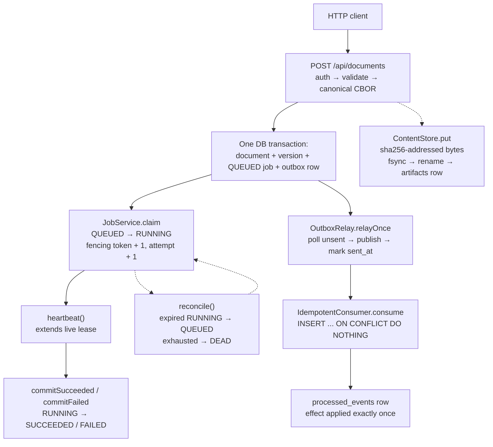

# C1 — System context

Who is inside versus outside, and where tenant trust stops. Detail lives here; `docs/architecture.md` is the index.

## Actors and externals

- Tenants: HTTP clients sending `X-Tenant-Id` plus `Idempotency-Key`. Tenant is the authority for every read and write; query `tenant` params are ignored.
- Operator: runs `docker compose up --build`, probes `/healthz` + `/readyz`, tails JSON logs by `correlationId`.
- Postgres 18: source of truth, queue, and outbox (Flyway V1–V4, RLS `FORCE`, `anvil_app` `NOSUPERUSER NOBYPASSRLS`).
- Filesystem CAS root (`anvil.cas.root`, default `var/cas`): per-tenant `tenants/{tenant}/{sha}`, no cross-tenant dedup.
- Exec workspaces root (`anvil.exec.root`, default `var/exec-workspaces`): per-tenant writable directory only.
- What is out in v1: broker, K8s, Redis, OpenSearch, gRPC, streaming, gVisor. Polling first; `LISTEN/NOTIFY` wake-up only.

## System data flow

`POST /api/documents` → `X-Tenant-Id` auth → validate → canonical CBOR → one DB transaction (document + version + job + outbox) → `JobService` claim/heartbeat/commit/reconciler → `OutboxRelay` publish + `sent_at` mark → `IdempotentConsumer`. Bytes go through `ContentStore` (filesystem + `artifacts` rows).

## Entry contract

- Routes: `POST /api/documents` (aliases `/api/v1/documents`, `/documents`). Headers `X-Tenant-Id`, `Idempotency-Key`. Body `{"title","mime_type","body"}` where `body` is a JSON string treated as UTF-8 bytes for CBOR `bstr`. See `src/main/java/com/g1do/anvil/submit/SubmitController.java` and `src/main/java/com/g1do/anvil/submit/SubmitService.java`.
- Valid request returns `202` with `{"doc_id","version_id","job_id"}` on first and duplicate delivery; same `(tenant_id, idempotency_key)` returns the same IDs with exactly one job row (`UNIQUE(tenant_id, idempotency_key)`, fast-path re-read plus `DuplicateKeyException` replay of the winner).
- Canonical form: RFC 8949 core-deterministic over `{title, mime_type, body}` only (`jackson-dataformat-cbor` with `SORT_PROPERTIES_ALPHABETICALLY`); `version_sha = sha256(canonical_cbor)`. See `src/main/java/com/g1do/anvil/submit/CanonicalCbor.java`.
- Validation limits live in `SubmitService`: title required ≤4096, `mime_type` required ≤255, `Idempotency-Key` required ≤255, `body` must be present; unknown tenant → `401`.
