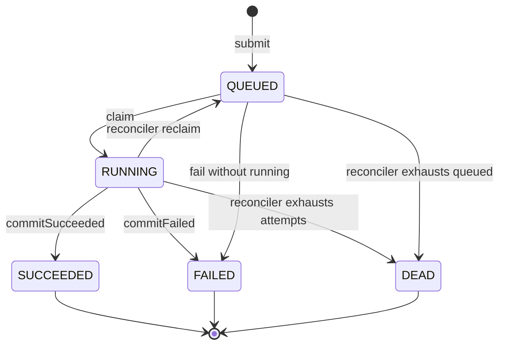

# C2 — Containers

Major applications, stores, and communication paths for the whole system. C1 is in `../c1.md`; per-slice internals live in `../slices/*/c3.md`; `../architecture.md` is the index.

## Modules

Application entry plus `tenant/` (`X-Tenant-Id` auth), `submit/` (CBOR, service, controller), `jobs/` (fenced claim, heartbeat, capability-gated commit, reconciler), `cas/` (crash-safe store, gateway, TTL-60s presigned URLs), `read/` (direct-ID fetches, title-prefix search), `audit/` (append-only chain writer plus read API), `exec/` (minimal jail, default-deny egress), `health/` (`/healthz`, `/readyz`, correlation IDs), `outbox/` (relay, idempotent consumer). See `src/main/java/com/g1do/anvil`.

## Jobs: fenced claim, heartbeat, commit, reconciler

See `src/main/java/com/g1do/anvil/jobs/JobService.java`.

- Claim is one atomic statement: candidates `WHERE tenant_id + state='QUEUED' + unheld/expired lease + attempt < max_attempts ORDER BY created_at, id LIMIT 20 FOR UPDATE SKIP LOCKED` (uses `jobs_claim_idx`), then `QUEUED -> RUNNING` with `fencing_token + 1`, `attempt + 1`, `lease = clock_timestamp() + 10s`. The `attempts` ledger row (`UNIQUE(tenant_id, job_id, attempt_number)`) is written in the same transaction: zero lost, zero doubled.
- Heartbeat extends only a live lease held by the same owner and token (`RUNNING` plus `lease_expires_at > clock_timestamp()`).
- `commitSucceeded/Failed` moves `RUNNING -> SUCCEEDED/FAILED` only when id plus owner plus fencing token plus `RUNNING` all match; a stale owner affects zero rows. Terminal rows (`SUCCEEDED/FAILED/DEAD`) are additionally immutable via the `job_state_guard` trigger.
- Capability gate (issue #21): every commit requires a valid `cap_grants` row for `(tenant_id, job_id)` (`V3__cap_grants.sql`: `UNIQUE(tenant_id, job_id)`, composite `FOREIGN KEY(tenant_id, job_id)`, `RLS FORCE`). `issueCap` epoch 1 (re-issue supersedes), `revokeCap` sets `revoked=TRUE`, expiry `clock_timestamp() + 1h` (DB clock only). Missing/revoked/expired/superseded/cross-tenant denies atomically: 0 job rows, `403 NEEDS_APPROVAL`, `cap_rejected++`. Post-grant TOCTOU is residual by definition.
- `reconcile(tenant)` / `reconcileAll()` polling reconciler (intended `1s`): expired `RUNNING` with attempts left returns to `QUEUED`; at or beyond `max_attempts` moves to `DEAD`. Terminals never claimable.

- Only the database clock (`clock_timestamp()`) decides leases. At-least-once with idempotent fenced effects; exactly-once is not asserted.

## Content store

See `src/main/java/com/g1do/anvil/cas/ContentStore.java`.

- `put(tenant, bytes)` returns `sha256(bytes)`, stored under `tenants/{tenant}/{sha}`; no cross-tenant deduplication. `get(tenant, sha)` re-verifies the hash.
- Durability order: tmp-write in destination directory → fsync file → atomic rename → fsync directory, then the `artifacts` row. Hash mismatch is a torn tail and is removed, never served (`CorruptContentException`).
- `acquire` / `release` drive `artifacts.refcount`. `collectGarbage()` deletes only `refcount = 0` rows older than `GC_grace=1h` (DB clock), re-checking each row `FOR UPDATE`; crash orphans swept by file mtime. Ambiguity retains.

## Reads: direct-ID, search, CAS gateway, presigned

See `src/main/java/com/g1do/anvil/read/ReadService.java`, `DocumentSearchController.java`, `src/main/java/com/g1do/anvil/cas/ContentStore.java` (`getForCaller`), `CasPresignedService.java`.

- Direct-ID fetches: every call sets `app.tenant` with read-back probe and queries `WHERE id = ? AND tenant_id = ?` under RLS `FORCE`. Cross-tenant IDs return empty same-as-missing (no oracle). Forged claim/commit deny via tenant-scoped `WHERE` plus capability gate.
- Search `GET /api/documents?query=&limit=&cursor`: tenant solely from `X-Tenant-Id`; `WHERE tenant_id = :t AND title ILIKE :prefix% ORDER BY created_at, id`, RLS underneath plus per-row re-check. No GIN/FTS. Cursor is a tenant-scoped document UUID; cross replay returns 0 rows. Limits default `20`, max `100`.
- CAS gateway `getForCaller(caller, resource, sha)`: denies without content when `caller != resource` or no `artifacts` row for `(caller, sha)`; traversal (`../`, `%2e%2e`) rejected before the filesystem.
- Presigned URLs (TTL `60s`, DB clock): `base64url(payload) + "." + HMAC-SHA256` binding `(tenant, sha, job, cap, epoch, expiry)`. Revoke/expire/supersede/cross denies `403 NEEDS_APPROVAL`.

## Outbox relay and consumer

See `src/main/java/com/g1do/anvil/outbox/OutboxRelay.java` and `IdempotentConsumer.java`.

- `relayOnce` per tenant polls `WHERE tenant_id = ? AND sent_at IS NULL ORDER BY id LIMIT 100 FOR UPDATE SKIP LOCKED` (uses `outbox_poll_idx`), publishes with stable identity (`outbox.id` as `event_id`), marks `sent_at` in a separate transaction after publish. Crash between publish and mark re-publishes rather than losing.
- `consume(event)` runs `INSERT INTO processed_events ON CONFLICT DO NOTHING` and applies only when the insert wins.

## Execution jail

See `src/main/java/com/g1do/anvil/exec/ExecJail.java`, `JailEgress.java`.

- Filesystem: per-tenant workspace only (`<anvil.exec.root>/<tenant>`). `resolveInWorkspace` denies absolute paths, `..`, `%`, null bytes, symlink traversals. `readWorkspaceFile(caller, resource, rel)` denies cross-tenant without oracle.
- Process: forked child, working directory = tenant workspace, cleared env (`env -i` equivalent; only `PATH=/usr/bin:/bin`, `ANVIL_TENANT`, validated extras). Shell interpreters, absolute/`..`/`%` operands, workspace executables deny. Stdout/stderr capped 1 MiB per stream. No shell.
- Egress default-deny (`JailEgress.checkAllowed`, no allowlist in v1); `HttpClient` with `followRedirects(NEVER)`. Residual: no mount/user/network namespace, no DNS-rebind re-check, no nftables DROP.

## Database

Migrations in `src/main/resources/db/migration/`: V1 durable slice (`tenants, documents, document_versions, jobs, attempts, artifacts, outbox, processed_events`, `job_state_guard`, claim/relay indexes, `claimable_jobs` views); V2 RLS `FORCE` (migrator owns, `anvil_app` `NOSUPERUSER NOBYPASSRLS`, one policy per table, `security_invoker=true` views); V3 `cap_grants`; V4 `audit_events` (see `slices/o3/c3.md`). Every tenant transaction sets `SET LOCAL app.tenant` via `TenantGuard.setTenant` with read-back probe; missing context reads 0 rows.

## Health and observability

See `src/main/java/com/g1do/anvil/health/HealthController.java`, `CorrelationIdFilter.java`, `src/main/resources/logback-spring.xml`, `Dockerfile`, `docker-compose.yml`.

- `GET /healthz` liveness, no dependency checks; `GET /readyz` readiness with `SELECT 1` (200 ready, 503 not-ready). Both bypass tenant auth. Same `/readyz` is the startup probe where orchestration requires it.
- Structured JSON logs (Logstash encoder) with `correlationId` from `X-Request-Id`/`X-Correlation-Id` or generated UUID, echoed as `X-Correlation-Id`; no secrets.
- `Dockerfile` multistage minimal unprivileged (`temurin:25-jre`, user `anvil:10001`). `docker-compose.yml` mirrors prod (real `postgres:18` + app). One-command start `docker compose up --build`; verify `curl localhost:8080/healthz` then `curl localhost:8080/readyz`.
